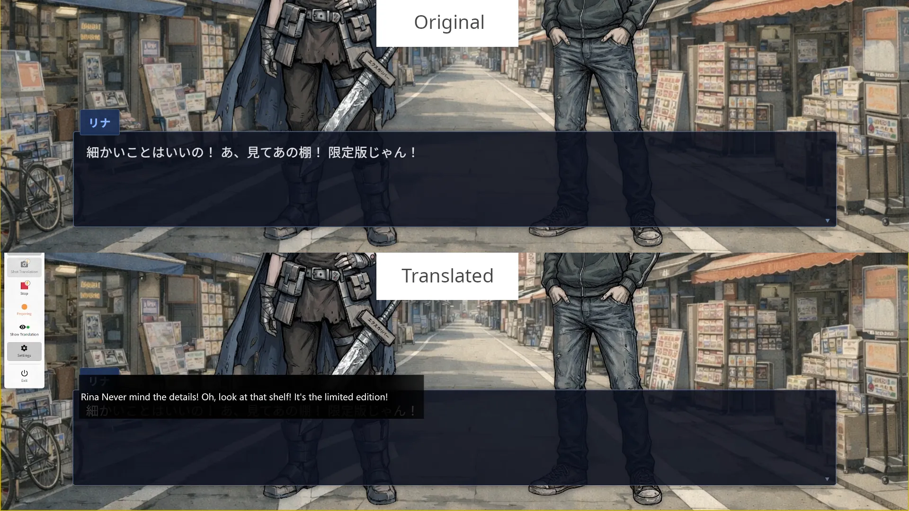
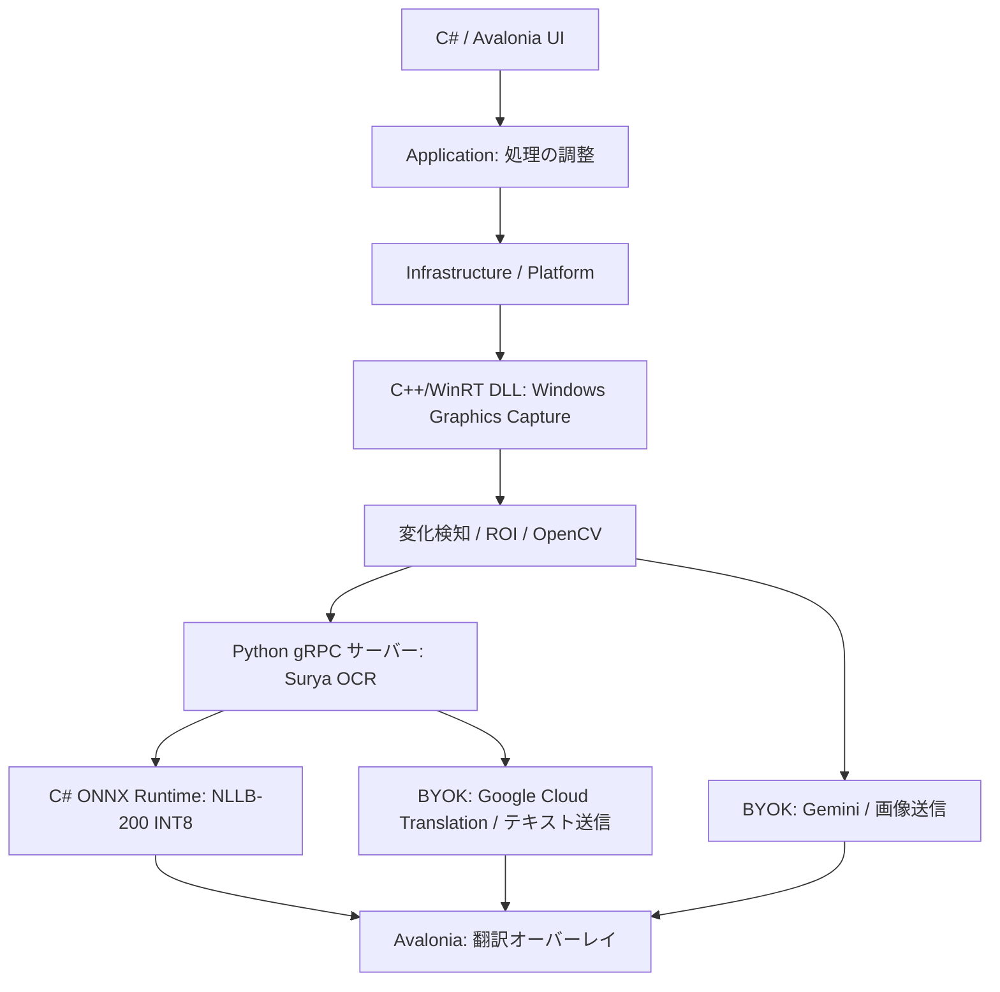

# Baketa

**開発は終了しました。2026-11-14 公開の v1.0.0 が最終版です。今後の保守・サポートは行いません。**

[公式サイト](https://baketa.app) · [最終版 v1.0.0](https://github.com/koizumiiiii/Baketa/releases/tag/v1.0.0) · [Releases・モデル配布](https://github.com/koizumiiiii/Baketa/releases)

Baketa is a Windows game translation overlay built with C#, Avalonia, C++/WinRT and Python.
Development ended with v1.0.0 on November 14, 2026; no maintenance or support is provided.
The final release uses local NLLB translation or your own Google API key, without a Baketa account or backend.
This repository remains as a development portfolio.

ゲーム画面の文字を読み取り、翻訳を透過オーバーレイで表示するWindows専用アプリです。
画面キャプチャ、変化検知、OCR、翻訳、描画をつなぐ実装と、その設計・運用の記録を残しています。

## デモ



[英語デモ動画](docs/pages/assets/demo/demo-en.mp4) · [日本語デモ動画](docs/pages/assets/demo/demo-ja.mp4)

## 最終版の動作

| 翻訳方法 | 処理と送信内容 |
|---|---|
| ローカル NLLB-200 | Surya OCRで認識し、C# ONNX Runtimeで翻訳。翻訳APIの利用料なし |
| Gemini（BYOK） | 利用者自身のAPIキーでGoogleに画像を送信 |
| Google Cloud Translation（BYOK） | 利用者自身のAPIキーでGoogleにOCRテキストを送信 |

ログイン・課金・Baketaのサーバーは不要です。初回のコンポーネント取得と、利用者が選択したGoogle APIへの通信を行います。アプリの自動更新確認は行いません。Google APIの利用条件・料金は利用者の契約に従います。

## 構成と処理の流れ

Coreに抽象・イベントを置き、Applicationが処理を調整し、InfrastructureとWindows専用Platform層が実装を提供します。UIはAvalonia / ReactiveUIです。下図の矢印は処理・呼び出しの流れで、プロジェクトの参照依存を表すものではありません。



翻訳はPR #451でC#の直接推論へ移行しました。[OnnxTranslationEngine](Baketa.Infrastructure/Translation/Onnx/OnnxTranslationEngine.cs)がONNXセッションを管理し、Python側は[OCR専用サーバー](grpc_server/BaketaUnifiedServer.spec)として構成しています。

## 設計判断と技術的な工夫

- **変化した領域に処理を絞る:** [ROI Manager設計](docs/3-architecture/roi-system/roi-manager.md)に基づき、テキスト出現位置の学習とゲーム別プロファイルを使います。[変化検知の実装](Baketa.Infrastructure/Imaging/ChangeDetection/EnhancedImageChangeDetectionService.cs)で不要なOCR処理を抑える構成です。
- **翻訳をC#プロセスで完結させる:** [ONNXエンジン](Baketa.Infrastructure/Translation/Onnx/OnnxTranslationEngine.cs)はCPU実行、INT8モデル、decoderのKVキャッシュを使用します。推論をロックで直列化し、セッションとキャッシュの扱いをエンジン内に集約しています。
- **外部送信の選択を明確にする:** [Geminiの画像送信](Baketa.Infrastructure/Translation/Cloud/GeminiImageTranslator.cs)と[Googleのテキスト送信](Baketa.Infrastructure/Translation/Cloud/GoogleTranslationEngine.cs)を分離し、ローカル翻訳も選べます。
- **言語ごとの実行環境を分離する:** WindowsキャプチャはC++/WinRT、UIと翻訳はC#、Surya OCRはPythonとし、OCRサーバーをPyInstallerで配布します。

最終版の同一条件で再現できる性能比較を確認できないため、速度倍率・VRAM削減率は掲載していません。
過去にはCloudflare WorkersのRelay Server、Supabase Auth、Patreon連携による認証・課金基盤を構築・運用していました。[旧構成の記録](docs/3-architecture/external-services.md)と[撤収手順](ops/sunset/README.md)は履歴資料です。

## 制約・既知の限界

- Windows x64専用です。ネイティブキャプチャDLLとWindows用ランタイムを使用します。
- CUDA版OCRは対応するNVIDIA GPUとドライバーが必要です。CPU版も用意していますが、速度や必要メモリは画像・モデル・環境に依存します。NLLB翻訳はCPUで実行します。
- OCRの読み取り誤りや翻訳の誤訳があり、ゲームのフォント・背景・画面変化によって結果が変わります。
- NLLB-200のモデルはCC-BY-NC-4.0（非商用）です。Suryaのコードとモデル重みも別ライセンスです。本体のMITライセンスだけで全コンポーネントを扱うことはできません。[第三者ライセンス一覧](THIRD-PARTY-NOTICES.md)を参照してください。
- 保守終了後のOS・ドライバー・外部API変更への追従はありません。

## 利用・再現手順

[最終版](https://github.com/koizumiiiii/Baketa/releases/tag/v1.0.0)のZIPを展開して `Baketa.exe` を実行します。初回はOCRサーバー・翻訳モデルなどを取得します。

### コンポーネントを手動配置する場合

自動取得が利用できない場合は、アプリを終了し、以下の固定ファイルを取得してください。配置先は `Baketa.exe` のあるフォルダを基準とします。

| ファイル（取得元） | SHA-256 |
|---|---|
| [CPU版](https://github.com/koizumiiiii/Baketa/releases/download/models-v3/BaketaUnifiedServer-cpu.zip) | `206de3f54cd2eb7ac19bb6c1969bf4f8cb046ae6a67c3b6c84d97ffd69582660` |
| [CUDA版 .001](https://github.com/koizumiiiii/Baketa/releases/download/models-v3/BaketaUnifiedServer-cuda.zip.001) | `06389f7adf0c8439f82b71ef5beb84bb3a880738c44c000289932bd0a9ab4b21` |
| [CUDA版 .002](https://github.com/koizumiiiii/Baketa/releases/download/models-v3/BaketaUnifiedServer-cuda.zip.002) | `5ccb1dcb3f3fc2001584c6e17c904ca472de430f27bfeb1be326ba3814b6a1fc` |
| [NLLBモデル](https://github.com/koizumiiiii/Baketa/releases/download/models-v3/nllb-200-onnx-int8.zip) | `3c9a53969f3153f390f3acf57df4c1262495eb3a57fb6cb1af058b1bb6bae639` |
| [tokenizer.json（固定コミット）](https://huggingface.co/facebook/nllb-200-distilled-600M/resolve/f8d333a098d19b4fd9a8b18f94170487ad3f821d/tokenizer.json) | `e316b82de11d0f951f370943b3c438311629547285129b0b81dadabd01bca665` |

PowerShellの `Get-FileHash -Algorithm SHA256 <ファイル名>` で各ファイルを検証し、不一致なら配置しないでください。CPU版またはCUDA版のどちらかを選びます。CUDA版は両パーツを検証した後、同じフォルダで**コマンドプロンプト**から結合します（結合後全体のハッシュは未取得）。

```cmd
copy /b BaketaUnifiedServer-cuda.zip.001+BaketaUnifiedServer-cuda.zip.002 BaketaUnifiedServer-cuda.zip
```

- サーバーZIPの内容を `grpc_server\BaketaUnifiedServer` に展開し、直下に `BaketaUnifiedServer.exe` がある状態にします。
- モデルZIPの内容を `Models\nllb-200-onnx-int8` に展開し、直下に `encoder_model_quantized.onnx` がある状態にします。
- `tokenizer.json` を `Models\nllb-200-onnx-int8\tokenizer.json` に配置します。ZIP内のフォルダ名を二重に重ねないでください。

上記の検証ファイルが存在すればインストール済みとして扱われます。`component-metadata/*.meta.json` の作成は不要で、起動時の更新確認や再取得は行いません。`tokenizer.json` が不足している場合のみ、別途補完取得されます。

#### Surya OCR モデル重みの手動配置

Surya のモデル重みは初回 OCR 時に `https://models.datalab.to` から自動取得されます。標準のキャッシュ先は `%LOCALAPPDATA%\datalab\datalab\Cache\models` です。

- 検出: `text_detection\2025_05_07`（約74MB）
- 認識: `text_recognition\2025_09_23`（約1.4GB）

取得できない環境では、同じバージョンで OCR が動作している PC と移行先の Baketa を終了し、動作している PC の上記 `models` フォルダを移行先の同じパスへコピーしてください。フォルダ構造と付随ファイルを含めてコピーします。サイズは目安です。`MODEL_CACHE_DIR` などを環境設定で変更している場合は、実際のキャッシュ先を使用してください。

### 開発者向け

Windows x64、.NET 8 SDK、Visual Studio 2022のC++開発環境とWindows SDK、Python 3.10を使用します。[CLAUDE.md](CLAUDE.md)のビルド手順に従い、ネイティブDLL、PyInstallerによるOCRサーバー、.NETソリューションの順にビルドします。`grpc_server/dist/BaketaUnifiedServer/BaketaUnifiedServer.exe` が存在すると、`Baketa.UI/Baketa.UI.csproj` の `CopyUnifiedServer` ターゲットが.NETビルド後にサーバーを出力先へ自動コピーします。

```powershell
# Visual Studio Developer PowerShellで、リポジトリ直下から実行
msbuild BaketaCaptureNative\BaketaCaptureNative.sln /p:Configuration=Debug /p:Platform=x64

# CPU版OCRサーバーの環境（CUDA版とは別に作成）
Set-Location grpc_server
py -3.10 -m venv venv_build
.\venv_build\Scripts\pip.exe install -r requirements-lock-cpu.txt
.\venv_build\Scripts\pyinstaller.exe BaketaUnifiedServer.spec
Set-Location ..

# .NETビルド後にOCRサーバーを出力先へ自動コピー
dotnet build --configuration Debug --arch x64

dotnet test
dotnet run --project Baketa.UI --configuration Debug
```

CUDA版は `grpc_server` 内で `py -3.10 -m venv venv_build_cuda` を実行し、その環境のpipで `requirements-lock-cuda.txt` をインストールし、同環境のPyInstallerで同じspecをビルドします。モデル配置は上記手順を参照してください。

[CPUロック](grpc_server/requirements-lock-cpu.txt)・[CUDAロック](grpc_server/requirements-lock-cuda.txt)はビルド環境のスナップショットです。公開済みバイナリのビルド時点と完全一致する保証はありません。Pythonやprotoを変更した場合は、PyInstallerでサーバーを再ビルドしてから `dotnet build --configuration Debug --arch x64` を実行し、出力先へ自動コピーします。

## 資料とコントリビューション

[ドキュメント一覧](docs/README.md)には開発中・旧サービス時代の資料も含まれます。現行動作は最終版のコードと本READMEを参照してください。
開発終了につき、機能追加・修正のコントリビューションやサポート依頼は受け付けません。

## ライセンス・謝辞

Baketa本体は[MIT License](LICENSE)です。同梱・初回取得するライブラリとモデルには別の条件が適用されます。[THIRD-PARTY-NOTICES.md](THIRD-PARTY-NOTICES.md)に採用バージョン、確認根拠、未確認事項を記載しています。

[Surya OCR](https://github.com/VikParuchuri/surya)、[Meta NLLB-200](https://huggingface.co/facebook/nllb-200-distilled-600M)、[Avalonia](https://avaloniaui.net/)、[OpenCV](https://opencv.org/)と各依存プロジェクトに感謝します。
